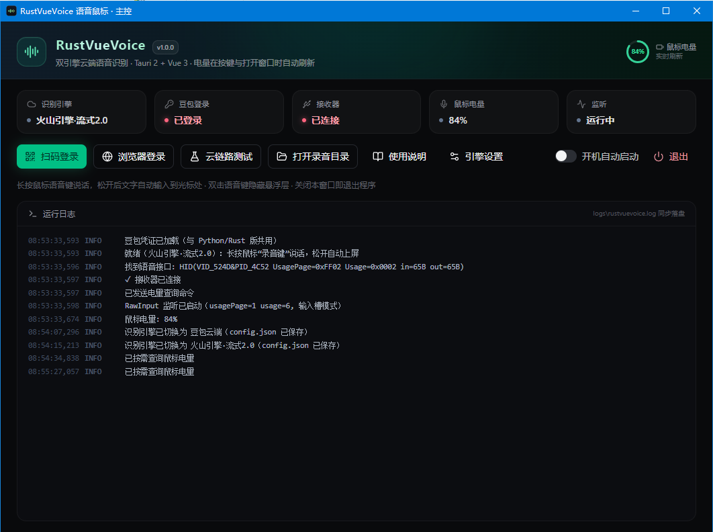
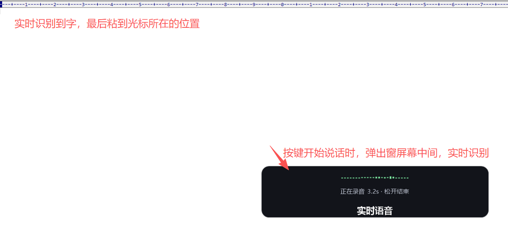

# RustVueVoice 语音鼠标

**Rulink / MR08 智能语音鼠标**-------- 适合-- **氛围编程**vibe coding和 **客服** 等使用场景,开源请勿商用，请勿推广


MR08 是一款冷门但极具性价比的**无线充电**鼠标：支持**蓝牙、2.4GHz 双模连接**与**多设备切换**，网上售价性价比极高。本项目让这只鼠标脱离官方驱动，接入豆包/火山引擎云端语音识别，长按语音键说话，松开后识别文字自动输入到光标位置，并复制进剪贴板。支持豆包云端（免费）与火山引擎流式语音识别 2.0（付费，更稳更准）双引擎。

## 界面预览

主控窗口 —— 状态卡、功能按钮与实时运行日志：



按键说话时屏幕中央弹出悬浮胶囊，实时显示识别文字与音量波形，松开后文字上屏：



## 快速上手

1. 双击 `RustVueVoice.exe` 打开主控窗口；
2. 首次使用点击「扫码登录」，在弹出的窗口里用手机豆包 App 扫码（或手机号 + 验证码登录），登录完成后窗口自动识别登录态；另一种选择是火山引擎付费引擎（火山开通就送20小时可以用很久）
3. 打开任意可输入的窗口（记事本 / Word / 聊天框）；
4. 长按鼠标上的语音键（侧面语音键 / 翻译键 / A键 任意一个）说话；
5. 松开后文字自动输入到光标位置，并复制进剪贴板。

## 准备工作（重要）

- 鼠标接收器插入 USB，鼠标拨到 **ON（2.4G 模式，非蓝牙）**；
- 官方驱动 `Rulink.exe` **必须完全退出**（任务管理器确认），否则音频通道会被官方驱动抢走；
- 需要系统已安装 **Microsoft Edge WebView2 运行时**（Win10/11 一般自带）。

## 手势说明

| 操作 | 效果 |
| --- | --- |
| 长按语音键 | 录音；松开结束并自动上屏 |
| 按住 < 0.2 秒 | 视为误触，自动取消 |
| 快速短按两下 | 隐藏 / 收起屏幕中央的悬浮胶囊层 |

屏幕中央胶囊悬浮窗实时显示识别文字与音量波形（原生绘制、点击穿透、不抢焦点）。

## 主窗口功能

- **扫码登录**：弹出豆包登录窗口（应用内 WebView），Cookie 过期会自动提示重新登录；
- **浏览器登录**：在系统浏览器登录 doubao.com 后自动收割登录态（备选方式）；
- **云链路测试**：取最近一段录音发送云端，验证整条链路；
- **引擎设置**：切换识别引擎 / 配置火山引擎 API Key（见下节）；
- **开机自动启动**：开启后写入注册表（`HKCU\...\Run`），开机自动运行；
- **打开录音目录**：每次录音的 WAV 与识别文本（同名 `.txt`）都保存在 exe 旁的 `recordings` 目录；
- **状态卡**：识别引擎 / 豆包登录 / 接收器 / 鼠标电量 / 监听；电量在按下语音键与打开主窗口时自动刷新（绿色 ≥ 20%，红色 < 20%）；
- **运行日志**：实时滚动显示，同步写入 `logs\rustvuevoice.log`。

## 火山引擎付费引擎（可选，识别更稳更准）

本程序支持火山引擎「流式语音识别大模型 2.0（小时版）」作为付费识别引擎（`volc.seedasr.sauc.duration`）：API 契约稳定（不再依赖网页 Cookie），默认开启二遍识别 / 标点 / 数字规整（ITN）。

开通步骤：

1. 打开火山引擎控制台开通服务，开通「流式语音识别大模型 2.0（小时版）」（新用户开通即送 20 小时识别时长），网址：
   <https://console.volcengine.com/speech/new/setting/activate?ResourceID=volc.seedasr.sauc.duration&_vtm_=a106466.b106468.0_0.0_0.0.215_7701485951495521827&projectName=default>
2. 开通后在「控制台 > API Key 管理」创建一个 API Key 并复制；
3. 回到主窗口，点击「引擎设置」：识别引擎选择「火山引擎·流式语音识别 2.0」，粘贴 API Key，点击保存；
4. 用「云链路测试」验证整条链路（状态卡会显示当前引擎）。

说明：

- API Key 仅保存在本机 exe 旁的 `config.json`，不上传给任何第三方；
- 小时版按识别音频时长计费，具体价格以火山引擎计费页为准；
- 切回免费引擎：在「引擎设置」中选回「豆包云端（免费）」即可。

## 命令行

```text
RustVueVoice.exe --check          自检（接收器/凭证）
RustVueVoice.exe --probe a.wav    云端链路冒烟测试
RustVueVoice.exe --login          打开登录窗口，完成后退出
RustVueVoice.exe --import-browser 从系统浏览器收割豆包登录 cookie
RustVueVoice.exe --overlay-demo   悬浮层动效演示
```

## 常见问题

- **提示「未收到鼠标音频数据」**：确认接收器已插、鼠标为 2.4G 模式、官方驱动已退出；
- **提示「豆包连接失败」**：检查网络，或用「云链路测试」定位；
- **电量一直显示「—」**：鼠标休眠时无应答属正常，按一下语音键或重新打开主窗口即可刷新；
- **凭证文件**：与 Python/Rust 旧版共用（`%USERPROFILE%\.config\doubao-input\asr_params.json`），各版本可互换使用，无需重复登录；
- **配置文件** `config.json`（exe 旁，可选）：可自定义 VID/PID、按键、输出方式（unicode / ctrl_v）、录音与日志目录等。
- **更多问题** 请发邮件给 jxdingp1981@gmail.com
## 隐私说明

录音仅在按下语音键期间采集，并上传豆包云端完成识别；cookie 解密与存储全部在本机完成，本程序不采集其它数据。


